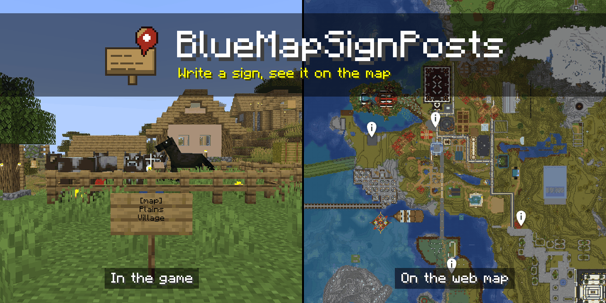
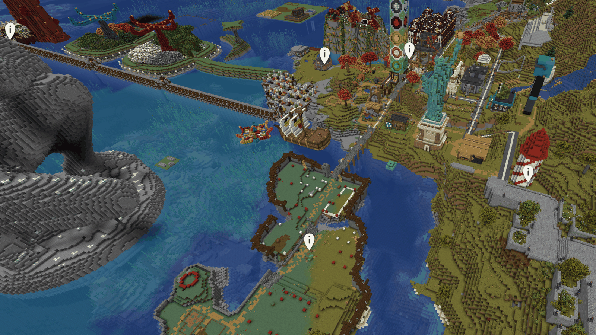
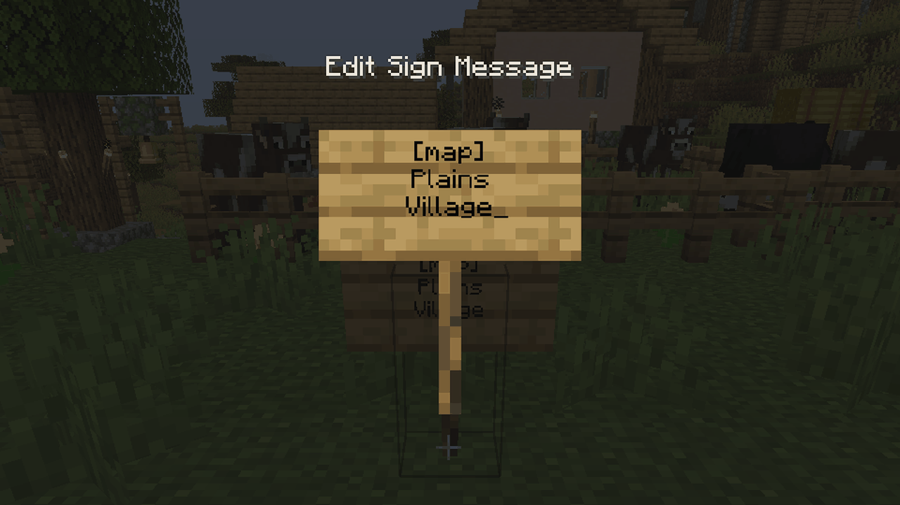

<p align="center">
  <a href="LICENSE"></a>
  <a href="https://github.com/lewisgibson/bluemap-sign-posts/releases/latest"></a>
  
  
  
</p>

A Paper plugin that allows players to add markers to your [BlueMap](https://bluemap.bluecolored.de/) web map using signs and banners. Write `[map]` on the first line of a sign and the name of the place underneath, or place a banner renamed in an anvil, and a marker with that name appears on the map at that block. Edit the sign to rename the marker, and break it to remove it.

This is an unofficial, community plugin. It is not affiliated with, authorised by, or endorsed by BlueMap, PaperMC or Mojang.



## Requirements

Paper or Purpur 26.3, with BlueMap 5.24 or newer installed on the same server. Folia is supported in the code and will be tested once Folia 26.3 is released. See [compatibility](docs/compatibility.md) for what is tested.

## Install

1. Install [BlueMap](https://modrinth.com/plugin/bluemap) and let it render your world once.
2. Download the jar from [Modrinth](https://modrinth.com/plugin/bluemapsignposts) or the [latest release](https://github.com/lewisgibson/bluemap-sign-posts/releases/latest).
3. Put it in your server's `plugins` folder and restart the server.

The defaults work as they are. To upgrade, replace the jar and restart; your markers and settings are kept.

## Adding a place



Put `[map]` alone on the first line and the place's name on the lines below. Click Done and the marker appears on the map, with its name and who placed it. Signs of every kind work, on either side, and so does a banner renamed in an anvil. [Signs and banners](docs/usage.md) has the details.

## Settings

The settings are in `plugins/BlueMapSignPosts/config.yml`, and `/signposts reload` applies them. Some you may want to change:

| Setting             | Default  | What it does                                        |
| ------------------- | -------- | --------------------------------------------------- |
| `sign.trigger`      | `[map]`  | The first line that turns a sign into a marker      |
| `limits.default`    | `10`     | How many markers each player may have               |
| `required-playtime` | `0s`     | How long a player must have played to add one       |
| `storage.type`      | `sqlite` | Where markers are kept: SQLite, PostgreSQL or MySQL |

[Configuration](docs/configuration.md) explains every setting, and [storage](docs/storage.md) covers the databases.

## Commands

Players can run `/signposts list` to see their own markers. Admins, with `bluemapsignposts.admin`, can list everyone's, remove a marker, set a player's limit and reload the settings:

```
/signposts list all
/signposts remove world -220 77 393
/signposts limit set Steve 25
/signposts reload
```

[Commands and permissions](docs/commands-and-permissions.md) lists them all, with the permission tiers for limits.

## Documentation

- [Signs and banners](docs/usage.md)
- [Configuration](docs/configuration.md)
- [Commands and permissions](docs/commands-and-permissions.md)
- [Storage](docs/storage.md)
- [BlueMap markers](docs/bluemap-markers.md)
- [Compatibility](docs/compatibility.md)
- [Troubleshooting](docs/troubleshooting.md)
- [FAQ](docs/faq.md)

## Contributing

Contributions are welcome. [CONTRIBUTING.md](CONTRIBUTING.md) explains how to build and test the plugin, and [architecture](docs/architecture.md) describes the code.

## Acknowledgements

- [BlueMap](https://github.com/BlueMap-Minecraft/BlueMap) by Blue (Lukas Rieger) draws the map. Markers go through its [BlueMapAPI](https://github.com/BlueMap-Minecraft/BlueMapAPI) (MIT).
- [Paper](https://papermc.io/) is the server the plugin is built for (GPL-3.0).
- Paper downloads [HikariCP](https://github.com/brettwooldridge/HikariCP) (Apache-2.0), the [PostgreSQL driver](https://github.com/pgjdbc/pgjdbc) (BSD-2-Clause) and the [MariaDB driver](https://github.com/mariadb-corporation/mariadb-connector-j) (LGPL-2.1) for the plugin when it first loads.

## License

GPL-3.0, see [LICENSE](LICENSE). The jar contains only the plugin's own code; see [THIRD-PARTY-NOTICES.txt](THIRD-PARTY-NOTICES.txt).
