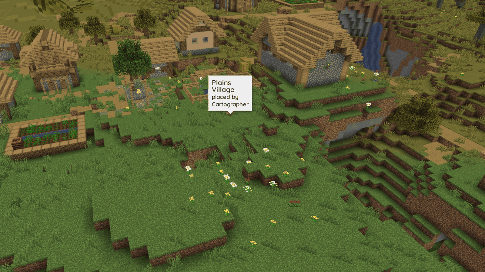

# Signs and banners

Put a place on your server's BlueMap with a sign or a renamed banner. These examples use the default trigger, `[map]`. Your server owner can [change it](configuration.md#signtrigger).

## Writing a sign

Write the trigger on the first line, with nothing else on that line. Capitals and surrounding spaces don't matter. Write the place's name on the lines below. The plugin trims spaces from each line, skips blank lines and joins the rest with one space.

| Line 1        | Line 2      | Line 3    | Line 4 | Result                                           |
| ------------- | ----------- | --------- | ------ | ------------------------------------------------ |
| `[map]`       | `Spawn`     |           |        | A marker named `Spawn`                           |
| `[map]`       | `Plains`    | `Village` |        | `Plains Village`                                 |
| `[MAP]`       | `Miner's`   | `Rest`    |        | `Miner's Rest`                                   |
| `[Map]`       | `North`     |           | `Farm` | `North Farm`                                     |
| `[map]`       | `The Great` | `Nether`  | `Hub`  | `The Great Nether Hub`                           |
| `[map]`       |             |           |        | No marker; you are asked to add a name           |
| `Shop`        | `[map]`     |           |        | No marker; the trigger must be on the first line |
| `[map] Spawn` |             |           |        | No marker; the trigger must be alone             |
| `map`         | `Spawn`     |           |        | No marker; the brackets are part of the trigger  |

The name keeps the letters you typed, including their capitalisation. Dye, glow ink and formatting from other plugins do not carry over: the map shows plain text. Names longer than 100 characters are cut at 100 without splitting a character. Ordinary signs rarely reach that length, and an anvil name is at most 50 characters.

### Which signs work

Standing, wall and hanging signs work in every wood. The marker sits at the sign's own block.

### Both sides of a sign

Since Minecraft 1.20, signs have a front and a back. The front decides whenever its first line is the trigger, even if it has no name. The plugin reads the back only when the front has no trigger. You can keep directions on the front and put `[map]` on the back.

| Front                | Back              | Result                       |
| -------------------- | ----------------- | ---------------------------- |
| `[map]` / `Spawn`    | anything          | `Spawn`                      |
| `Welcome!`           | `[map]` / `Spawn` | `Spawn`                      |
| `[map]` with no name | `[map]` / `Spawn` | No marker; the front decides |
| `Welcome!`           | `Hello!`          | No marker                    |

### Waxed signs

Waxing a sign with honeycomb stops anyone editing it. You cannot rename or remove its marker by editing, but breaking the sign still removes it.

## Renaming a place

Right-click the sign and change the lines under `[map]`. Click Done to update the marker. You see `Updated on the map: <name>` in chat. Editing your own marker does not use another slot or check your playtime again.

If you edit somebody else's signpost and leave it as a valid `[map]` sign, the marker becomes yours. Your permission, limit and playtime are checked as for a new marker. It counts towards your limit instead of the previous owner's.

If you are not allowed to add a marker, the old marker is removed. A marker belongs to whoever last wrote the sign. Vanilla Minecraft lets any player edit an unwaxed sign.

## Taking a place off the map

These actions remove a marker:

- Break the sign or banner. Whoever breaks it sees `Removed from the map: <name>`.
- Edit the sign so it no longer has a trigger on either side. The sign stays with its new text.
- Leave the deciding side's trigger in place but remove the name underneath.
- Destroy the block through an explosion, piston, wither or another mob, or remove the block it stands or hangs on by breaking, exploding or burning it.
- Run the admin command `/signposts remove <world> <x> <y> <z>`. This leaves the block alone.

Some changes fire no event: `/setblock`, `/fill`, WorldEdit edits, logging-plugin rollbacks, restored world backups and changes made while the plugin was absent. When a chunk containing stored signposts next loads, the plugin checks each one against its block and removes any that no longer match. An orphaned marker can remain until that chunk loads. Use `/signposts remove` to remove it immediately.

## Banners

Rename a banner in an anvil, then place it as a standing or wall banner. It becomes a marker with that name. You do not need to write anything on it.

A banner keeps its custom name when broken and picked up, so you can move its marker by breaking and placing it again. To rename a placed banner, break it, rename it in an anvil and place it again.

Banner names become plain text, just like sign names. An unnamed banner creates no marker. Neither does a banner the game refuses to place, for example inside spawn protection.

Server owners can disable new banner markers with [`banners.enabled: false`](configuration.md#bannersenabled).

## When a player isn't allowed a marker

Your sign is still written or your banner placed whenever the game allows it. The plugin only refuses the marker. These are the default chat messages; your server owner can change or silence them.

| Reason                            | Message                                                                                                 |
| --------------------------------- | ------------------------------------------------------------------------------------------------------- |
| You lack the create permission    | `You can't add markers to the map.`                                                                     |
| You have not played long enough   | `You need 2h of playtime to add markers to the map. You've played 1h20m - 40m to go.`                   |
| You have reached your limit       | `You already have 10 markers on the map (the limit is 10). Break one of your signposts to free a slot.` |
| Your sign has `[map]` but no name | `Write the name of the place on the lines under [map].`                                                 |

Breaking one of your signposts frees its slot immediately. [Commands and permissions](commands-and-permissions.md#limits) explains how your limit is calculated.

## What players see on the map

Each marker is a pin in the **Signposts** layer, unless your server owner has renamed it. Hover over or click the pin to see the place's name and who added it.

You can hide the layer in BlueMap's marker menu. Nether and End signposts appear on their dimension's own map.

Signposts stay stored and listed in `/signposts list` when a world unloads. They are put back on the map when it loads again, including worlds loaded after server startup. A world without a BlueMap map keeps its signposts but cannot display them until BlueMap maps it. See [BlueMap markers](bluemap-markers.md).
